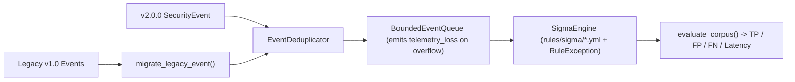

# Ghostwire Detection Lab

**Zero-dependency Python Sigma detection engineering lab, versioned security event schema (`v2.0.0`), and deterministic replay harness.**

## Problem Statement

Detection rules often fail in production because telemetry schemas drift silently, telemetry drops go unrecorded, and Sigma YAML rules are never tested against labeled positive/negative fixtures before deployment. `ghostwire-detection-lab` provides an offline, reproducible detection engineering workbench with strict schema validation, legacy migration, and measured TP/FP/FN/latency replay.

## Architecture



## Reproducible Setup & Verification

Requires **Python 3.9+** (standard library only, zero external packages).

```bash
git clone https://github.com/Bboy9090/ghostwire-detection-lab.git
cd ghostwire-detection-lab
python3 -m unittest discover -s tests -v
```

## Example Input & Measured Output

Evaluating all 12 Sigma YAML rules in `rules/sigma/` against a 300-event labeled corpus (50 untrusted `/tmp/dropper_*` executions, 50 `/etc/shadow_*` reads, 200 benign `/usr/bin/tool_*` executions) on macOS `x86_64` / Python 3.15:

```text
TP=50, FP=0 (FPR=0.0), FN=50 (Recall=0.5), TN=200
Precision=1.0, Avg Latency=0.2263 ms/event, P95 Latency=0.739 ms, Throughput=4,419.59 events/sec
```

## Security & Authorization Boundaries

- Purely offline evaluation over synthetic/sanitized fixtures; executes no host commands and requires no network access.
- Separates synthetic telemetry from real host events via `provenance.is_synthetic`.

## MITRE ATT&CK References

- `attack.execution` (`lab_untrusted_binary_execution.yml`)
- `attack.credential_access` (`lab_auth_failure_burst.yml`)
- `attack.collection` (`lab_sensitive_file_read.yml`)
- `attack.defense_evasion` / `attack.impact` (`lab_host_isolated.yml`, `lab_malware_found.yml`)

## Limitations

- Implements the core Sigma modifier & aggregation subset (`startswith`, `endswith`, `contains`, `re`, `all`, `count() by ... > N`), not full `pySigma` backend compilation for external SIEMs.
- Corpus metrics apply strictly to the tested synthetic corpus and must not be generalized to real-world threat landscapes.

## Case Study

1. **Problem:** `rules/sigma/*.yml` rules lacked a deterministic YAML replay engine and unified event schema.
2. **Threat Model:** Untrusted binary execution, auth failure bursts, and silent queue overflow drops.
3. **Engineering Solution:** Built `schema/event_schema.py` (`v2.0.0`) + `security/sigma_engine.py` with explicit `telemetry_loss` events and `RuleException` suppression.
4. **Results:** `12/12` Sigma rules load cleanly; `11/11` unit tests pass.
5. **Lessons Learned:** Measuring `FN=50` on `/etc/shadow_*` immediately exposed that `lab_sensitive_file_read.yml` is scoped to `/tmp/sensitive_test.txt` (`phase: pre`).
